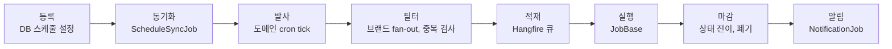

# 1. 통합 스케줄러 플랫폼

| | |
|---|---|
| 기간 | 2026.04 ~ 2026.07 구축, 운영 중 |
| 역할 | 단독 설계, 개발, 운영 (1명) |
| 기술 스택 | .NET 8, ASP.NET Core, Hangfire, Cronos, Dapper, EF Core, MS SQL Server, Serilog + Seq, React, JWT, Polly |

> **설계 문서**: 코어 실행 엔진(Job 등록, 큐 격리, CRON 동기화, 공통 Job 베이스, 늦은 Job 폐기, 중복 실행 방지, 실행 시간 한도, 전역 일시정지)의 구조와 설계 이유는 [`ARCHITECTURE.md`](ARCHITECTURE.md) 에 정리했습니다.

## 배경

20여 개 스케줄러 프로그램이 제각각 배포되어 Windows 작업 스케줄러로 실행되고 있었습니다. 브랜드를 하나 추가할 때마다 코드 수정과 재배포가 필요했고, 브랜드 단위 실행이나 일시정지, 즉시 실행 같은 운영 기능이 없었습니다.

## 담당 역할 및 실행

- **설계**: 스케줄 설정을 코드에서 DB로 옮기기로 하고, 이를 담을 DB 스키마와 백엔드 구조를 처음부터 설계했습니다. 스케줄 업무(도메인)의 기본값 위에 브랜드별 설정만 덮어쓰는 2계층 상속 구조를 고안했습니다. 브랜드 설정의 필드는 모두 비워 둘 수 있고, 비워 둔 필드는 기본값을 물려받습니다.
- **구현**: 등록부터 알림까지 이어지는 실행 흐름을 하나의 파이프라인으로 표준화했습니다. 페이로드 검증, 상태 전이, 타임아웃, 실패 마감, 알림은 공통 Job 베이스가 맡고, 새 Job 은 `ExecuteCoreAsync` 하나만 구현합니다. 운영자가 직접 쓰는 React 관리 콘솔도 함께 만들었습니다.
- **운영**: 레거시 스케줄러를 단계적으로 이관했고 전환 이후 운영을 직접 맡고 있습니다.

## 성과

- 브랜드 추가가 재배포에서 설정 등록으로 바뀌었고, 운영자가 화면에서 브랜드 단위 즉시 실행과 일시정지를 직접 수행합니다.
- 스케줄 업무 80종, 고객사 브랜드 30여 개를 배포 없이 운영합니다. 브랜드별 설정은 326건, Job 유형은 74종입니다.
- 하루 평균 9천 건, 누적 135만 건을 시스템 장애 없이 성공률 100%로 처리했습니다(2026년 11월 기준).

## 구조

실행 흐름은 등록부터 알림까지 8단계 파이프라인입니다. DB 의 스케줄 설정이 원본이고 Hangfire 의 반복 작업은 거기서 만들어집니다. 반복 작업은 도메인 단위로만 등록하고 발사 시점에 브랜드별로 펼치므로, 브랜드가 늘어도 등록되는 반복 작업 수는 그대로입니다.

| 단계 | 담당 코드 |
|---|---|
| 등록, 동기화 | `ScheduleSyncJob` — DB 스케줄(원본)을 Hangfire RecurringJob(파생)으로 매분 복제 |
| 발사, 필터, 적재 | `Dispatcher` + Hangfire 필터 — cron, 브랜드 수동 실행, 도메인 수동 실행 세 진입점이 같은 경로를 공유 |
| 실행, 마감 | `JobBase` + `JobLogRepository` — 모든 상태 전이에 from-status 가드 |
| 알림 | `NotificationJob` — 실행 워커와 분리된 알림 전용 큐 |

## 코드 안내

네 폴더 모두 운영 코드 원문입니다. 회사, 브랜드, 서버, DB 카탈로그 이름만 일반화했고 로직은 그대로입니다. 설계가 드러나는 파일만 골라 옮겼으므로 이 폴더만으로 빌드되지는 않습니다.

### 1) 설정으로 확장하는 구조 · [`1.ConfigurationInheritance/`](1.ConfigurationInheritance/)

스케줄 설정을 코드에서 DB 로 옮긴 부분입니다. 도메인 기본값 위에 브랜드별 설정을 덮어쓰는 2계층 구조이고, 브랜드 설정에서 비워 둔 값은 도메인 값을 물려받습니다.

| 파일 | 내용 |
|---|---|
| [`Entities/SchDomain.cs`](1.ConfigurationInheritance/Entities/SchDomain.cs) · [`Entities/SchDomainSchedule.cs`](1.ConfigurationInheritance/Entities/SchDomainSchedule.cs) | 상위 계층. 도메인(Job 유형, 기본 큐)과 도메인 기본 스케줄(cron, 유효 기간, 실행 한도, 큐 대기 한도, 기본 페이로드) |
| [`Entities/SchDomainBrandOverride.cs`](1.ConfigurationInheritance/Entities/SchDomainBrandOverride.cs) · [`Entities/SchDomainBrandCron.cs`](1.ConfigurationInheritance/Entities/SchDomainBrandCron.cs) | 하위 계층. 브랜드별 cron, 실행 한도, 큐 대기 한도, 페이로드, 큐가 모두 nullable 이고 null 이면 도메인 값을 상속. 브랜드별 시간대 cron 은 여러 개 둘 수 있음 |
| [`Entities/`](1.ConfigurationInheritance/Entities/) 의 나머지 | 브랜드, 도메인 그룹(N:M 매핑), 큐, 브랜드별 추가 메일 수신자, 실행 이력 보관 테이블. 사용 여부(USE_YN)와 테스트 여부(TEST_YN)를 단위별로 가짐 |
| [`ScheduleRepository.cs`](1.ConfigurationInheritance/ScheduleRepository.cs) | **상속 병합이 일어나는 곳**. 네 테이블을 조인해 `o.TimeoutSec ?? s.TimeoutSec` 처럼 브랜드 값이 없으면 도메인 값을 쓰고, 도메인·그룹·브랜드의 사용 여부와 유효 기간으로 활성 대상을 걸러 냄 |
| [`SchedulerHubDbContext.cs`](1.ConfigurationInheritance/SchedulerHubDbContext.cs) | EF Core 매핑. 복합 키, 연쇄 삭제, 실행 이력 코드 컬럼의 비유니코드 지정 |

### 2) 표준화된 실행 파이프라인과 공통 프레임워크 · [`2.ExecutionPipeline/`](2.ExecutionPipeline/)

등록부터 알림까지의 실행 흐름과 공통 Job 베이스입니다.

| 파일 | 내용 |
|---|---|
| [`Core/JobBase.cs`](2.ExecutionPipeline/Core/JobBase.cs) | **공통 Job 베이스**. 단일 try/catch 로 페이로드 역직렬화, DataAnnotations 검증, ENQUEUED 에서 RUNNING 전이, shutdown+timeout linked token, 비즈니스 실행, SUCCESS/FAILED 마감, 알림까지 처리. 마감·알림 단계만 예외를 삼키고 원본 예외는 `ExceptionDispatchInfo` 로 스택 트레이스를 보존해 다시 던짐 |
| [`Core/Dispatcher.cs`](2.ExecutionPipeline/Core/Dispatcher.cs) | 발사·필터·적재. 도메인 cron tick 1회에 활성 브랜드 fan-out, 브랜드 시간대 cron(OR) narrowing, 활성 Job 중복 검사(1회 SELECT), Hangfire enqueue |
| [`Core/ScheduleSyncJob.cs`](2.ExecutionPipeline/Core/ScheduleSyncJob.cs) | 등록·동기화. UPD_DT 체크포인트 + 등록셋과 활성셋의 양방향 reconcile |
| [`Core/DeprecationSweeper.cs`](2.ExecutionPipeline/Core/DeprecationSweeper.cs) · [`Infrastructure/Hangfire/`](2.ExecutionPipeline/Infrastructure/Hangfire/) | 마감 보조. 큐 대기 한도(DEPRECATE_SEC)와 실행 한도(TIMEOUT_SEC)를 넘긴 Job 을 필터(실행 직전)와 스위퍼(매분 SQL 스캔) 두 지점에서 폐기 |
| [`Core/NotificationJob.cs`](2.ExecutionPipeline/Core/NotificationJob.cs) | 알림. 시스템/브랜드 두 수신자 그룹의 발송 여부 판단, 본문, 발송을 각각 독립 처리 |
| [`Infrastructure/JobLogRepository.cs`](2.ExecutionPipeline/Infrastructure/JobLogRepository.cs) | 상태 전이 저장소. 모든 전이가 from-status 가드 + 행수 반환으로 멱등, `MarkRunningOutcome` 으로 정상 race(DEPRECATED)와 정합성 깨짐을 구분 |
| [`Core/DomainJobRegistry.cs`](2.ExecutionPipeline/Core/DomainJobRegistry.cs) · [`Core/IDomainJob.cs`](2.ExecutionPipeline/Core/IDomainJob.cs) | DB 의 JOB_TYPE(짧은 클래스명)을 Type 으로 매핑. 중복 이름은 기동 시 바로 실패 |
| [`Jobs/DBReindexJob.cs`](2.ExecutionPipeline/Jobs/DBReindexJob.cs) · [`Jobs/MailTestJob.cs`](2.ExecutionPipeline/Jobs/MailTestJob.cs) | 파생 Job 예시 — `ExecuteCoreAsync` 하나만 구현 |
| [`Models/`](2.ExecutionPipeline/Models/) · [`Infrastructure/`](2.ExecutionPipeline/Infrastructure/) | 페이로드(`JobArgs`), 상태(`JobStatus`), 예외, 옵션, 로깅 확장, Polly SQL 재시도 파이프라인 |

### 3) 장애 격리와 운영 제어 · [`3.FaultIsolationAndOperations/`](3.FaultIsolationAndOperations/)

큐마다 Hangfire 서버를 따로 띄우고 알림을 전용 큐로 분리해, 한 작업의 지연이나 실패가 다른 큐로 번지지 않게 했습니다. 운영자는 전역 일시정지, 단위별 사용 여부, 테스트 모드로 개발자 없이 직접 대응합니다.

| 파일 | 내용 |
|---|---|
| [`SchedulerHangfireExtensions.cs`](3.FaultIsolationAndOperations/SchedulerHangfireExtensions.cs) | 큐 테이블(SCH_QUEUE)의 행마다 서버를 하나씩 띄우고 워커 수를 그 행의 값으로 지정. 반복 작업 전용 서버와 알림 전용 서버를 따로 등록. 중복 방지, 늦은 Job 폐기, 보존 기간 필터도 여기서 등록 |
| [`HangfireNotifier.cs`](2.ExecutionPipeline/Infrastructure/Notifiers/HangfireNotifier.cs) · [`NotificationJob.cs`](2.ExecutionPipeline/Core/NotificationJob.cs) (2.ExecutionPipeline) | 실행 워커는 알림 큐에 enqueue 만 하고 즉시 반환, 발송은 알림 전용 워커가 수행 |
| [`OperationalControl/DispatchPauseStore.cs`](3.FaultIsolationAndOperations/OperationalControl/DispatchPauseStore.cs) · [`DispatchPauseController.cs`](3.FaultIsolationAndOperations/OperationalControl/DispatchPauseController.cs) | **전역 일시정지**. 상태를 파일에 원자적으로 저장하고 메모리에 캐시해, 매분 도는 발사 경로에 I/O 를 추가하지 않음. 누가, 언제, 왜 멈췄는지 남기고, 수동 실행은 일시정지와 무관하게 통과 |
| [`OperationalControl/RunNowController.cs`](3.FaultIsolationAndOperations/OperationalControl/RunNowController.cs) | **수동 실행**. 브랜드 하나 또는 도메인 전체를 즉시 enqueue. 운영 실행과 테스트 실행을 구분하고, 이미 실행 중인 대상은 건너뛴 사유를 응답에 담음 |
| [`ScheduleRepository.cs`](1.ConfigurationInheritance/ScheduleRepository.cs) (1.ConfigurationInheritance) | **단위별 사용 여부와 테스트 모드** 판정. 도메인, 그룹, 브랜드, 브랜드별 설정 중 하나라도 꺼져 있으면 자동 발사에서 빠지고, 도메인·그룹·브랜드 중 하나라도 테스트로 표시되면 본 로직만 건너뜀 |
| [`StateExpirationFilter.cs`](3.FaultIsolationAndOperations/StateExpirationFilter.cs) | 성공, 삭제 상태 Job 의 보존 기간을 설정값으로 지정 |

### 4) 관리 콘솔과 안정화 · [`4.OperationsConsoleAndStabilization/`](4.OperationsConsoleAndStabilization/)

운영자가 쓰는 관리 콘솔 코드입니다. 조회는 관리자 백엔드가 스케줄러 DB 를 직접 읽고, 실행이나 일시정지처럼 스케줄러 프로세스가 해야 하는 일은 관리자 백엔드가 내부망의 스케줄러 API 로 넘깁니다.

| 파일 | 내용 |
|---|---|
| [`AdminApi/DashboardRepository.cs`](4.OperationsConsoleAndStabilization/AdminApi/DashboardRepository.cs) · [`DashboardController.cs`](4.OperationsConsoleAndStabilization/AdminApi/DashboardController.cs) | 대시보드 집계. 다음 실행 예정 시각을 Cronos 로 계산하고, 발사됐어야 할 예상 목록과 실제 실행 이력을 맞춰 봄 |
| [`AdminApi/JobLogReadRepository.cs`](4.OperationsConsoleAndStabilization/AdminApi/JobLogReadRepository.cs) · [`JobLogsController.cs`](4.OperationsConsoleAndStabilization/AdminApi/JobLogsController.cs) | 실행 이력 조회 |
| [`AdminApi/NextRunsController.cs`](4.OperationsConsoleAndStabilization/AdminApi/NextRunsController.cs) · [`CronService.cs`](4.OperationsConsoleAndStabilization/AdminApi/CronService.cs) | 실행 예정 조회(브랜드, 도메인, 예정 시각 순으로 좁혀 봄)와 cron 식 검증 |
| [`AdminApi/SchedulerProxyClient.cs`](4.OperationsConsoleAndStabilization/AdminApi/SchedulerProxyClient.cs) · [`RunsProxyController.cs`](4.OperationsConsoleAndStabilization/AdminApi/RunsProxyController.cs) · [`DispatchPauseProxyController.cs`](4.OperationsConsoleAndStabilization/AdminApi/DispatchPauseProxyController.cs) | 수동 실행과 일시정지 요청에 사용자 JWT 를 실어 스케줄러에 그대로 전달 |
| [`SchedulerApi/JobLogsController.cs`](4.OperationsConsoleAndStabilization/SchedulerApi/JobLogsController.cs) | 대기 중이거나 실행 중인 Job 을 운영자가 즉시 종료. Hangfire 상태와 실행 이력이 어긋나 있으면 Hangfire 의 실제 결과로 맞춤 |
| [`SchedulerApi/JobCatalogService.cs`](4.OperationsConsoleAndStabilization/SchedulerApi/JobCatalogService.cs) · [`CatalogController.cs`](4.OperationsConsoleAndStabilization/SchedulerApi/CatalogController.cs) | Job 유형과 페이로드 형식을 리플렉션으로 읽어 콘솔의 선택 목록과 입력 양식에 제공 |
| [`AdminConsole/`](4.OperationsConsoleAndStabilization/AdminConsole/) | React 콘솔 화면 4개(실행 이력, 실행 예정, 일시정지, 수동 실행)와 API 훅, 타입 |
| [`LegacyBridge/LegacyBridgeClient.cs`](4.OperationsConsoleAndStabilization/LegacyBridge/LegacyBridgeClient.cs) · [`BridgeProcess/Program.cs`](4.OperationsConsoleAndStabilization/LegacyBridge/BridgeProcess/Program.cs) | 레거시 압축 포맷 호환. .NET 8 이 풀지 못하는 .NET Framework 전용 직렬화 포맷을 별도 프로세스(.NET Framework 4.7.2)가 풀고, 두 프로세스는 표준 입출력으로 데이터를 주고받음 |
| [`Logging/SerilogExtensions.cs`](4.OperationsConsoleAndStabilization/Logging/SerilogExtensions.cs) · [`AppLogEnricher.cs`](4.OperationsConsoleAndStabilization/Logging/AppLogEnricher.cs) | Serilog 설정. 모든 로그에 시스템 이름과 애플리케이션 이름을 붙임 |
