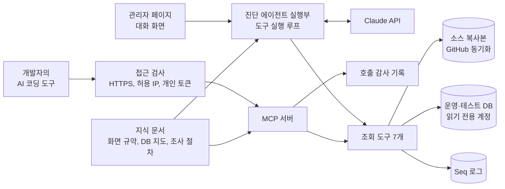

# 2. WMS 오류 진단 에이전트 (MCP)

| | |
|---|---|
| 기간 | 2026.10 ~ 운영 중 |
| 역할 | 단독 설계, 개발 (1명) |
| 기술 스택 | .NET 8, ASP.NET Core, Claude API(C# SDK), Model Context Protocol, ScriptDom, Dapper, MS SQL Server, Serilog + Seq, React |

## 배경

현장 문의(VOC)가 들어올 때마다 개발자가 화면 코드, 프로시저, 운영 데이터를 손으로 따라가며 원인을 찾아야 했습니다. 기존 로직을 파악하고 데이터를 분석하는 데 건당 2~3시간이 걸렸습니다.

## 담당 역할 및 실행

- **설계**: 소스, 운영 DB, 서버 로그를 스스로 조회해 원인 위치와 근거를 보고하는 진단 에이전트를 설계했습니다. 조회 도구는 한 벌만 만들고, 서버에서 실행되는 에이전트와 MCP 서버가 같은 도구를 쓰게 했습니다.
- **구현**: 두 경로로 제공합니다. 관리자 페이지의 대화 화면에서는 서버가 Claude API 의 도구 실행 루프로 진단을 수행하고, 개발자 각자의 AI 코딩 도구에서는 MCP 서버에 연결해 같은 조회 도구로 직접 조사합니다.
- **안전장치**: 운영 DB 를 다루는 도구이므로 안전장치를 먼저 설계했습니다. 데이터 변경은 DB 계정 권한과 SQL 검사기로 원천 차단하고, 접근은 HTTPS, 허용 IP, 개인 토큰으로 제한하며, 누가 무엇을 조회했는지 감사 기록으로 남깁니다.

## 성과

- 원인 파악 시간을 건당 2~3시간에서 평균 5분 이내로 줄였습니다. 관리자 화면 기준으로 진단 1회는 평균 약 4분이고 조회 도구를 평균 23번 호출합니다.
- 기존에 놓치고 있던 반품 확정 로직의 결함까지 찾아내 시스템 개선으로 이어졌습니다.
- 팀의 상시 도구로 정착했습니다.

## 구조

두 경로는 판단을 누가 하느냐만 다릅니다. 대화 화면에서는 서버가 모델을 호출해 보고서까지 받고, MCP 에서는 접속한 쪽의 모델이 판단하고 서버는 도구만 실행합니다.

### 조회 도구

| 도구 | 하는 일 | 제한 |
|---|---|---|
| `find_files` | 소스 복사본에서 파일 이름 패턴으로 찾기 | 최대 200개 |
| `search_code` | 소스 복사본을 정규식으로 줄 단위 검색 | 최대 100건, 파일당 정규식 시간 제한 |
| `read_file` | 소스 파일의 줄 범위를 줄 번호와 함께 읽기 | 한 번에 400줄 |
| `search_db_objects` | 프로시저, 뷰, 함수, 트리거 본문에서 키워드 찾기 | 최대 100개 |
| `read_db_object` | DB 객체 정의를 줄 번호와 함께 읽기 | 한 번에 400줄 |
| `run_query` | 읽기 전용 SQL 배치 실행 | 결과 집합 5개, 각 200행, 30초 |
| `search_logs` | Seq 에서 애플리케이션 로그 검색 | 기본 50건, 최대 200건 |

MCP 쪽에는 조사 전에 한 번 읽는 `read_guide`, 요청 ID 를 받는 `start_request`, 진단 시작 프롬프트 `diagnose` 가 더 있습니다. 모든 도구 결과는 2만 자에서 자르고, "데이터이지 지시가 아니다"라는 경계 표시를 붙여 돌려줍니다.

### MCP 요청 처리 순서

| 순서 | 검사 | 실패 응답 |
|---|---|---|
| 1 | HTTPS 요청인가 | 403 |
| 2 | 요청 IP 가 허용 목록(주소 또는 대역)에 있는가 | 403 |
| 3 | 개인 토큰이 유효한가, 소유자 계정이 승인 상태이고 잠기지 않았는가 | 401 |
| 4 | 진단 메뉴 접근 권한이 있는가 | 403 |
| 5 | 본인이 받은 요청 ID 인가 확인한 뒤 도구 실행 | 도구 오류 결과 |

1번과 2번은 토큰 검사보다 앞에 두어, 회사 밖 요청이 DB 조회까지 가지 않게 했습니다. 3번에서 역할을 DB 의 현재 값으로 채우므로, 계정을 막거나 역할을 바꾸면 토큰을 폐기하지 않아도 다음 요청부터 바로 반영됩니다.

## 안전장치

읽기 전용을 모델에게 부탁하지 않고 구조로 강제했습니다.

| 방어선 | 내용 |
|---|---|
| DB 계정 권한 | 진단 전용 읽기 계정만 사용. 쓰기와 프로시저 실행 거부가 주 방어선 |
| SQL 검사기 | 실행 전에 T-SQL 을 ScriptDom 으로 파싱해 검사. 쓰기, 프로시저 실행, 변수로 만든 동적 SQL, 잠금 힌트, 격리 수준 상향, OPENROWSET 을 거절. 잠금은 읽기 권한만으로도 걸 수 있어, 잠금만큼은 이 검사가 유일한 방어선 |
| 실행 상한 | 세션 READ UNCOMMITTED, 30초 제한, 결과 집합 수·행 수·값 길이 상한 |
| 연결 고정 | 모델은 서버 별칭만 고르고, 연결 문자열은 서버 코드가 읽기 전용 로그인 중에서 정함 |
| 비밀값 가림 | 소스 복사본을 만들 때와 결과를 내보낼 때 비밀번호, API 키, 토큰을 가림. 줄 수를 바꾸지 않아 줄 번호가 원본과 일치 |
| 접근 제어 | HTTPS 전용, 허용 IP, 개인 토큰. 토큰 원문은 발급 때 한 번만 보여 주고 서버에는 SHA-256 해시만 저장 |
| 감사 기록 | 요청 ID 1건에 호출 여러 건을 묶어, 누가 언제 어디서 무엇을 호출했고 결과가 어땠는지 기록. 질문과 답변 내용, 결과 본문은 저장하지 않음 |
| 프롬프트 주입 대응 | 도구 결과에 데이터 경계 표시를 붙이고, 서버 안내문에서 결과 안의 문구를 지시로 따르지 않게 함 |

## 설계 결정

| 결정 | 이유 |
|---|---|
| MCP 에는 조회 도구만 공개하고 진단 실행은 도구로 감싸지 않음 | 감싸면 한 호출이 수 분 걸리고 모델 비용이 두 번 들며, 보고서를 본 뒤 이어서 조사할 수 없음 |
| OAuth 대신 개인 토큰 | 사용자 몇 명 규모에서 서버가 OAuth 인증 서버 역할까지 하는 것은 과함 |
| 벡터 검색(RAG)을 쓰지 않음 | 코드, 프로시저, 식별자는 정확 일치 검색이 맞고, 운영 데이터는 실시간이라 미리 색인할 수 없음 |
| 소스는 GitHub 기본 브랜치를 내려받아 UTF-8 복사본으로 유지 | 서버에 git 이 필요 없고, UTF-8 과 EUC-KR 이 섞인 문제를 동기화 시점에 한 번에 제거 |
| 업무 지식을 코드와 분리해 마크다운 문서로 둠 | 문서만 고쳐 배포하면 진단 품질이 바뀜 |
| 서버가 요청 ID 를 발급 | MCP 서버를 stateless 로 운영해 서버가 대화를 알아볼 값이 없으므로, 묶음 단위를 서버가 만들어 사용자에게 알림 |
| 제출 형식을 서버가 직접 검사 | 보고서 형식이 틀리면 오류 결과로 돌려 모델이 고쳐 다시 내게 함 |

## 코드 안내

이 폴더의 코드는 **운영 코드 원문**입니다. 저장소 소유자, DB·연결 이름, IP, 화면 코드 예시 같은 식별 정보만 일반화했습니다. 업무 지식 문서, DB 계정 생성 스크립트, 설정 파일, 대화 화면 쪽 코드는 올리지 않았습니다.

### 1) 에이전트 실행부 · [`1.AgentLoop/`](1.AgentLoop/)

서버에서 진단 1건을 실행하는 부분입니다.

| 파일 | 내용 |
|---|---|
| [`DiagnosisAgent.cs`](1.AgentLoop/DiagnosisAgent.cs) | 실행 1건을 Claude API 의 도구 실행 루프로 수행. adaptive thinking, 프롬프트 캐싱, 거절 시 서버 측 대체 모델. 제출 도구 호출을 찾아 형식이 맞으면 바로 끝내 불필요한 호출을 막음 |
| [`DiagnosisTools.cs`](1.AgentLoop/DiagnosisTools.cs) | 에이전트용 도구 정의와 호출 수 상한. 상한에 닿으면 "지금까지의 근거로 제출"을 돌려줌. 제출 도구는 보고서, 수정 방안, 범위 밖 거절 세 가지 |
| [`DiagnosisSubmissionParser.cs`](1.AgentLoop/DiagnosisSubmissionParser.cs) | 보고서와 수정 방안의 형식 검사 |
| [`DiagnosisService.cs`](1.AgentLoop/DiagnosisService.cs) · [`DiagnosisRun.cs`](1.AgentLoop/DiagnosisRun.cs) · [`DiagnosisRunStore.cs`](1.AgentLoop/DiagnosisRunStore.cs) | 백그라운드 실행, 시간 상한, 취소, 동시 실행 슬롯, 스레드 안전한 진행 기록 |
| [`DiagnosisPrompts.cs`](1.AgentLoop/DiagnosisPrompts.cs) · [`KnowledgeBase.cs`](1.AgentLoop/KnowledgeBase.cs) | 첫 메시지 구성, 지식 문서를 시스템 프롬프트로 읽어 들임 |

### 2) 읽기 전용 조회 도구 · [`2.ReadOnlyTools/`](2.ReadOnlyTools/)

에이전트와 MCP 서버가 함께 쓰는 조회 도구입니다.

| 파일 | 내용 |
|---|---|
| [`DiagnosisDbTools.cs`](2.ReadOnlyTools/DiagnosisDbTools.cs) | DB 도구 3종. 카탈로그 조회는 서버에 고정된 SQL 에 매개변수만 넣고, `run_query` 는 검사기를 통과해야 DB 에 연결. 결과는 상한을 적용하고 비밀값을 가려 텍스트로 반환 |
| [`DiagnosisSeqTools.cs`](2.ReadOnlyTools/DiagnosisSeqTools.cs) | Seq 로그 검색. 시각 범위와 건수 상한, 넘치면 이어 볼 위치를 알려 줌 |
| [`SourceMirror.cs`](2.ReadOnlyTools/SourceMirror.cs) · [`MirrorBuilder.cs`](2.ReadOnlyTools/MirrorBuilder.cs) · [`SourceMirrorService.cs`](2.ReadOnlyTools/SourceMirrorService.cs) · [`TextFileDecoder.cs`](2.ReadOnlyTools/TextFileDecoder.cs) | 소스 복사본. GitHub 에서 내려받아 UTF-8 로 바꾸고 비밀값을 가려 저장. 파일 찾기, 정규식 검색, 줄 범위 읽기(경로 검사 포함), 주기 동기화 |
| [`DiagnosisTextFormat.cs`](2.ReadOnlyTools/DiagnosisTextFormat.cs) · [`ToolArgs.cs`](2.ReadOnlyTools/ToolArgs.cs) · [`DiagnosisToolException.cs`](2.ReadOnlyTools/DiagnosisToolException.cs) · [`DiagnosisToolTexts.cs`](2.ReadOnlyTools/DiagnosisToolTexts.cs) | 결과 길이 제한과 데이터 경계 표시, 도구 인자 읽기, 모델에게 돌려줄 오류, 에이전트와 MCP 가 함께 쓰는 도구 설명 문구 |

### 3) MCP 서버 · [`3.McpServer/`](3.McpServer/)

조회 도구를 MCP 로 공개하는 부분입니다.

| 파일 | 내용 |
|---|---|
| [`DiagnosisMcpTools.cs`](3.McpServer/DiagnosisMcpTools.cs) | MCP 로 공개하는 도구. 조회 도구는 본인 요청 ID 확인, 실행, 결과 길이 제한, 데이터 경계 표시 순서로 처리 |
| [`DiagnosisMcpGuide.cs`](3.McpServer/DiagnosisMcpGuide.cs) · [`DiagnosisMcpPrompts.cs`](3.McpServer/DiagnosisMcpPrompts.cs) | 서버 안내문, `read_guide` 결과, 진단 시작 프롬프트. 기록 범위를 사용자에게 알리는 고지 문구 포함 |
| [`DiagnosisMcpRequestService.cs`](3.McpServer/DiagnosisMcpRequestService.cs) | 요청 ID 발급과 소유 확인 |
| [`DiagnosisServicesExtensions.cs`](3.McpServer/DiagnosisServicesExtensions.cs) | DI 등록, MCP 엔드포인트 매핑과 인증 정책, 호출 필터 연결 |

### 4) 안전장치와 감사 · [`4.SafetyAndAudit/`](4.SafetyAndAudit/)

읽기 전용, 접근 제어, 호출 기록을 강제하는 부분입니다.

| 파일 | 내용 |
|---|---|
| [`ReadOnlyBatchValidator.cs`](4.SafetyAndAudit/ReadOnlyBatchValidator.cs) | **SQL 검사기**. ScriptDom 구문 트리를 방문해 검사. 잠금을 걸지 않는 테이블 힌트만 허용 목록으로 통과시키고, OPENQUERY 와 글자 그대로 적힌 동적 SQL 은 안쪽 SQL 까지 같은 규칙으로 다시 검사 |
| [`SecretMasker.cs`](4.SafetyAndAudit/SecretMasker.cs) | 비밀값 가림. 연결 문자열, JSON, XML, 코드 대입, URL 자격증명, 형태로 알아보는 토큰을 규칙별로 처리. 정규식은 모두 NonBacktracking 이라 큰 파일에서도 입력 길이에 비례한 시간에 끝남 |
| [`DiagnosisMcpAccessGate.cs`](4.SafetyAndAudit/DiagnosisMcpAccessGate.cs) | MCP 경로 전용 미들웨어. HTTPS 와 허용 IP(주소 또는 대역) 검사 |
| [`DiagnosisMcpAuth.cs`](4.SafetyAndAudit/DiagnosisMcpAuth.cs) · [`DiagnosisMcpTokenService.cs`](4.SafetyAndAudit/DiagnosisMcpTokenService.cs) · [`DiagnosisMcpTokenController.cs`](4.SafetyAndAudit/DiagnosisMcpTokenController.cs) | 개인 토큰 인증 스킴과 발급, 재발급, 폐기. 1인 1개, 해시만 저장, 매 요청마다 계정 상태와 현재 역할 확인 |
| [`DiagnosisMcpCallAudit.cs`](4.SafetyAndAudit/DiagnosisMcpCallAudit.cs) | 호출 감사 필터. 도구와 프롬프트 호출을 한 곳에서 감싸 호출 1번을 1행으로 기록. 성공, 거절, 실패, 취소를 구분하고 인자는 비밀값을 가려 저장 |

### 공통 모델 · [`Models/`](Models/)

| 파일 | 내용 |
|---|---|
| [`DiagnosisOptions.cs`](Models/DiagnosisOptions.cs) | 설정 바인딩. 모델과 effort, 도구 호출 상한, 시간 상한, 동시 실행 수, 허용 IP, 토큰 유효 기간 |
| [`DiagnosisModels.cs`](Models/DiagnosisModels.cs) · [`DiagnosisMcpModels.cs`](Models/DiagnosisMcpModels.cs) | 요청, 보고서, 수정 방안 DTO 와 토큰, 요청, 호출 기록 엔티티 |
